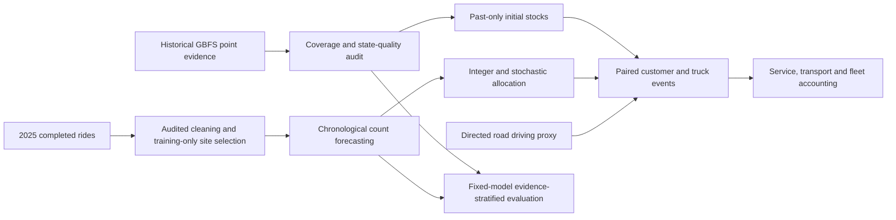

# Evidence-Aware Citi Bike Forecasting and Rebalancing

A computational research project on how uncertain count forecasts, imperfect state evidence and transport delays affect constrained resource allocation. The application is urban mobility; the methods connect to data science, stochastic optimization and financial engineering. Implementation and experiment execution were AI-assisted.

Start with the [two-page research brief](application/RESEARCH_BRIEF.pdf), [ten-page technical report](reports/technical_report.pdf), or [scoped claims and evidence](application/CLAIMS_AND_EVIDENCE.csv). Source and results are available; this is a project, not a peer-reviewed publication or a live Citi Bike dispatch system.

The pipeline retains 45.6 million NYC rides and builds a 262,800-row hourly panel for 30 training-selected stations. Four predictors use chronological training/validation/test splits. On 43,950 test station-hours, pooled XGBoost departure MAE is 3.418 versus 4.476 for last-hour, a 23.6% reduction.

A separate January 2026 evaluation froze protocol and fitted model hashes in Git before acquiring records. Unchanged XGBoost departure MAE is 2.705 versus 3.235 for last-hour on 22,320 new station-hours (16.4% lower). This is rolling one-step archived-count evaluation, without refitting or retuning.

The new evidence audit is more qualified: under the 15-minute enabled-start-state criterion, XGBoost is better on 33,131 supported starts, but worse on 10,819 unsupported starts (departure MAE 1.621 versus 1.480). This exploratory comparison reveals conditional weaknesses, without assuming missing-at-random evidence or identifying a causal missingness effect.

Count and paired-ride policy experiments cover 1,465 test hours. A separate 48-hour road scenario integrates two capacity-six co-loaded trucks, directed driving times, handling and driver limits, and complete fleet accounting. All 181 saved routes reconcile, but road MILP serves 94.498% of recorded departures versus 94.776% for no intervention. This negative result is retained.

Historical change archives do not recover every operating state. The 19,632 annual station-hours failing the strong sampling criterion remain unknown; this mask differs from the test start-state evidence stratum. Current collection cannot backfill 2025. Prospective cadence is checked against actual samples and trigger receipts; a deployed cron definition does not establish long-term continuity.

Reproduction, exact dependencies, source manifests and all baseline/extension commands are in [README_EN.md](README_EN.md). Local tests and successful remote CI cover leakage, constrained optimization, fleet accounting, archive integrity and evidence conditioning. For a quick inspectable example, run the synthetic validation; full raw-data reproduction is intentionally separate and much larger.

For graduate applications, see [application/](application/README.md) for financial engineering, data science and OR versions, along with contribution provenance and interview preparation. The project does not report financial returns, option pricing, real stockout reductions or publication status.

Standalone external reproduction: install requirements-lock.txt, then run `python scripts/external_202601.py`. Exact frozen model/context files are included in models/frozen_2025; no original2025 large partitions are required for this one evaluation.
